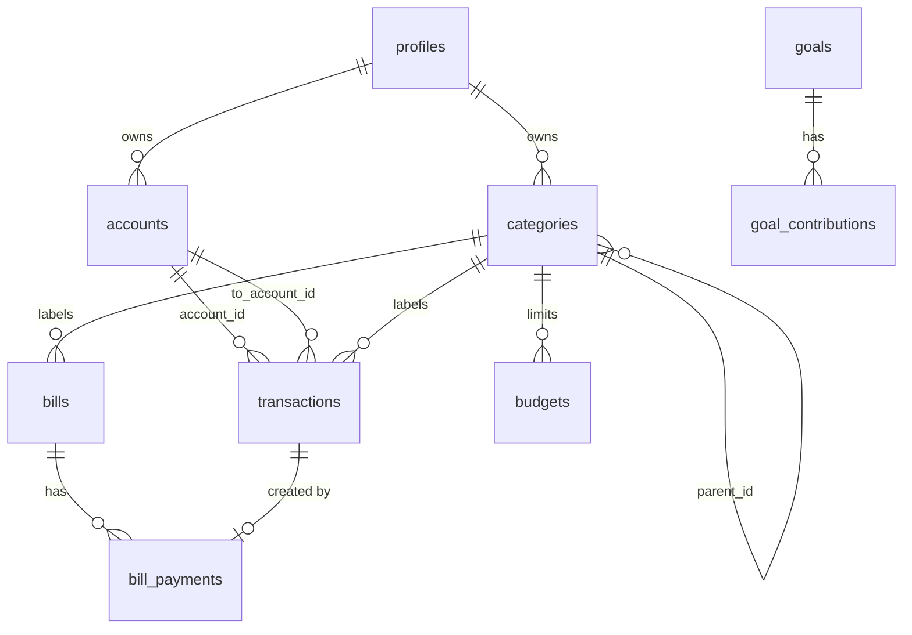

# Database schema

The full SQL lives in `docs/schema.sql`. Run it once in the Supabase SQL editor on a fresh project.

## Relationships



Every table except `profiles` has a `user_id` column that defaults to `auth.uid()`. The app never has to send it.

## Tables

| Table | Purpose | Notes |
| --- | --- | --- |
| `profiles` | One row per user | Name and currency. Created by a trigger on sign up |
| `accounts` | Cash bank and e-wallet accounts | `opening_balance` plus transactions gives the balance. `is_archived` hides an account |
| `categories` | Income and expense categories | `parent_id` makes a subcategory. Deleting a parent deletes its children |
| `transactions` | Income expense and transfer | `amount` is always positive. `type` sets the direction. Transfers use `to_account_id` |
| `bills` | One-time and recurring bills | `amount_paid` tracks the current cycle. `due_date` is the next due date |
| `bill_payments` | Payment history | Links to the expense transaction it created |
| `budgets` | Monthly limit per category | One budget per category. `alert_threshold` is a percent |
| `goals` | Savings goals | Optional `target_date` |
| `goal_contributions` | Money added to a goal | Positive amounts only |

## Enums

- `account_type`: cash bank ewallet
- `category_type`: income expense
- `transaction_type`: income expense transfer
- `bill_recurrence`: none weekly monthly yearly

## Rules the database enforces

- Amounts must be greater than zero.
- A transfer needs a destination account that is different from the source.
- Income and expenses must not have a destination account.
- Accounts that have transactions cannot be deleted. Archive them instead.
- A category is deleted with its subcategories. Transactions and bills that used it keep existing with no category.
- Budget alert thresholds sit between 1 and 100.
- One budget per category per user.

## Security

Row level security is on for every table. One policy per table allows all actions for the signed in user on rows they own.

A user cannot read or write another user's rows. Inserting a row with someone else's `user_id` is rejected.

## Functions and triggers

### `pay_bill(bill, amount, account, date)`

Pays all or part of a bill in one transaction.

1. Inserts an expense transaction.
2. Inserts a `bill_payments` row.
3. Adds the amount to `amount_paid`.
4. When the bill is fully paid: marks a one-time bill as paid or moves a recurring bill to its next due date and resets `amount_paid`.

It runs with the caller's permissions so row level security still applies.

### `handle_new_user()` and `seed_default_categories()`

A trigger on `auth.users` creates the profile and a starter set of categories for each new user. The starter set suits a student: Food and Dining Transport Housing Bills and Utilities Shopping Health Education Entertainment Other. Income has Salary Allowance Freelance Gifts Other income.

## Changing the schema

1. Change `docs/schema.sql` or write a migration.
2. Regenerate the types:

   ```bash
   npx supabase gen types typescript --project-id <ref> > src/lib/supabase/database.types.ts
   ```

3. Run `npm run typecheck` and fix anything it finds.
